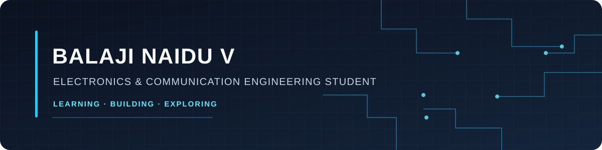

# Balaji Naidu V

**Electronics & Communication Engineering undergraduate** · Embedded systems · Digital design · Automotive software

I build and validate laptop-based and embedded-software projects across kernel mechanisms, RISC-V RTL, automotive networks, fault diagnosis, and edge-AI prototypes.

**Open to:** Embedded Systems / Firmware internships, Graduate Engineer Trainee (GET) opportunities, and entry-level ECE roles.

[Email](mailto:balu2004naidu@gmail.com) · [Try the interactive MICROKERNEL-X lab](https://balu2004naidu-hue007.github.io/MICROKERNEL-X/live.html) · [Browse all repositories](https://github.com/balu2004naidu-hue007?tab=repositories)

## Featured projects

| Project | Area | What I built |
|---|---|---|
| [MICROKERNEL-X](https://github.com/balu2004naidu-hue007/MICROKERNEL-X) · [Live lab](https://balu2004naidu-hue007.github.io/MICROKERNEL-X/live.html) | Embedded software / RTOS | Experimental C microkernel with scheduling, synchronization, IPC, memory pools, task recovery, a Cortex-M port, and an interactive WebAssembly lab. [CI runs](https://github.com/balu2004naidu-hue007/MICROKERNEL-X/actions) |
| [RISC-V DMA Controller](https://github.com/balu2004naidu-hue007/riscv-dma-controller) | RTL / SoC design | SystemVerilog DMA controller, arbitration, memory model, bare-metal C driver, and PicoRV32 integration tests. Simulation-verified; no FPGA claim. |
| [AutoCore ECU Simulation](https://github.com/balu2004naidu-hue007/AutoCore-Automotive-ECU-Simulation) | Automotive software | C++17 multi-ECU virtual CAN network with diagnostics, fault injection, controller Bus-Off recovery, and a local dashboard. |
| [AIBARS](https://github.com/balu2004naidu-hue007/AIBARS) | **C++17 embedded reliability** | **C++17 simulator and recovery engine** for fault injection, deterministic detection, diagnosis, bounded recovery, and verification; supported by Python analytics, black-box event recording, incident replay, and a local dashboard. |
| [Sugarcane Maturity Detector](https://github.com/balu2004naidu-hue007/Sugarcane-Maturity-Detector) | Embedded vision / Edge AI | ESP32-S3 image inference using a quantized YOLO11n model, browser interface, optional ESP32-CAM capture, and OLED output. It predicts image classes; it does not directly measure Brix. |
| [AI Industrial Equipment Health Monitoring](https://github.com/balu2004naidu-hue007/AI-Industrial-Equipment-Health-Monitoring) | Industrial monitoring | Python machine-data simulator, dashboard, optional serial ingestion, anomaly screening, and reproducible model-training workflow. |

## C++ implementation highlight — AIBARS

[**AIBARS is built around a C++17 simulator and recovery engine.**](https://github.com/balu2004naidu-hue007/AIBARS) The C++ core handles simulated telemetry, fault detection, rule-based diagnosis, bounded recovery actions, retry limits, and healthy-state verification. Python provides the supporting analytics, advisory classifier, campaign runner, and dashboard. This is a software simulation project; it does not claim physical ECU or industrial-hardware validation.

## Technical skills

**Languages:** C · C++ · Python · SystemVerilog

**Tools & platforms:** ESP-IDF · CMake · GCC · Clang/LLD · Icarus Verilog · GTKWave · QEMU · Git · GitHub Actions · HTML/CSS/JavaScript

**Engineering areas:** Embedded C · RTOS concepts · RISC-V · DMA · RTL simulation and verification · CAN · ECU diagnostics · Fault detection and recovery · Edge AI

## Selected validation evidence

| Project | Recorded software/simulation evidence |
|---|---|
| [RISC-V DMA Controller](https://github.com/balu2004naidu-hue007/riscv-dma-controller) | **26 Python reference-model tests passed; 8 extended RTL scenarios passed;** arbiter, firmware build, and PicoRV32 integration simulation passed. [Validation record](https://github.com/balu2004naidu-hue007/riscv-dma-controller/blob/main/docs/current_validation.md) · [CPU-vs-DMA simulator-cycle chart](https://github.com/balu2004naidu-hue007/riscv-dma-controller/blob/main/docs/evidence/cpu_vs_dma_simulator_cycles.svg) |
| [MICROKERNEL-X](https://github.com/balu2004naidu-hue007/MICROKERNEL-X) | **1,000 register-preservation checks passed; 2,002 ARM/QEMU context switches** recorded, alongside host and dashboard checks. [GitHub Actions](https://github.com/balu2004naidu-hue007/MICROKERNEL-X/actions) |
| [AIBARS](https://github.com/balu2004naidu-hue007/AIBARS) | Automated suite documents **9 focused C++ core checks and 24 Python test methods**, including recovery, replay, model-schema, and API checks. [Final validation report](https://github.com/balu2004naidu-hue007/AIBARS/blob/main/docs/final_validation.md) |
| [AI Industrial Equipment Health Monitoring](https://github.com/balu2004naidu-hue007/AI-Industrial-Equipment-Health-Monitoring) | Pytest suite and GitHub Actions CI cover the simulator, serial parser, scoring, dashboard API, and model-training pipeline. [CI workflow](https://github.com/balu2004naidu-hue007/AI-Industrial-Equipment-Health-Monitoring/actions) |

## Validation scope

These results are software tests and simulations, not proof of production readiness or physical-hardware performance. MICROKERNEL-X still needs physical Cortex-M validation; the RISC-V DMA controller has not been synthesized or tested on an FPGA; AutoCore and AIBARS are software simulations; and the industrial-monitoring ML workflow uses synthetic data. Each repository documents its setup, evidence, and limitations.
