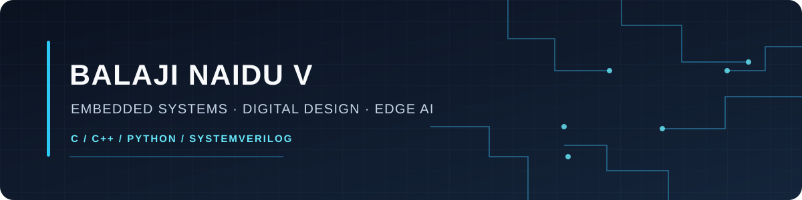

# Balaji Naidu V

**Embedded Systems & Digital Design** · Firmware · RTL · Edge AI

I’m an Electronics and Communication Engineering undergraduate building embedded software, digital systems, and applied prototypes. My projects range from kernel mechanisms and DMA hardware to automotive networks and on-device vision.

[Try the interactive MICROKERNEL-X lab](https://balu2004naidu-hue007.github.io/MICROKERNEL-X/live.html) · [Browse all repositories](https://github.com/balu2004naidu-hue007?tab=repositories)

## Featured projects

| Project | Area | What I built |
|---|---|---|
| [MICROKERNEL-X](https://github.com/balu2004naidu-hue007/MICROKERNEL-X) · [Live lab](https://balu2004naidu-hue007.github.io/MICROKERNEL-X/live.html) | Embedded software / RTOS | C kernel mechanisms for scheduling, synchronization, IPC, memory pools, and task recovery; includes a Cortex-M port and an interactive WebAssembly lab. Host, ARM/QEMU, dashboard, and deployment checks run in [GitHub Actions](https://github.com/balu2004naidu-hue007/MICROKERNEL-X/actions). |
| [RISC-V DMA Controller](https://github.com/balu2004naidu-hue007/riscv-dma-controller) | RTL / SoC design | SystemVerilog DMA controller, arbitration and memory model, bare-metal driver, and PicoRV32 integration tests. Verified in simulation; no FPGA performance claim. |
| [Sugarcane Maturity Detector](https://github.com/balu2004naidu-hue007/Sugarcane-Maturity-Detector) | Edge AI / agriculture | ESP32-S3 image inference with an optional ESP32-CAM capture board, browser interface, and OLED output. The model predicts image classes; it does not directly measure Brix. |
| [AutoCore ECU Simulation](https://github.com/balu2004naidu-hue007/AutoCore-Automotive-ECU-Simulation) | Automotive software | Four simulated ECUs on a virtual CAN network, diagnostics, fault scenarios, and a local dashboard. This is a software simulation, not a vehicle-connected system. |
| [AIBARS](https://github.com/balu2004naidu-hue007/AIBARS) | Embedded reliability | Simulated fault detection, diagnosis, bounded recovery, health verification, incident recording, and replay. Its ML classifier is advisory and trained on synthetic data. |
| [AI Industrial Equipment Health Monitoring](https://github.com/balu2004naidu-hue007/AI-Industrial-Equipment-Health-Monitoring) | Industrial monitoring | Laptop-runnable sensor simulator, dashboard, serial-input path, and Python model-training workflow. Model results use synthetic data and are not validated on industrial machines. |

## Technical areas

**Languages:** C · C++ · Python · SystemVerilog  
**Tools and platforms:** ESP-IDF · CMake · ARM/QEMU · GitHub Actions · HTML/CSS/JavaScript

## Validation and scope

Several projects include automated tests and documented simulation results. These validate the software scenarios described in each repository; they do not imply certification, production deployment, or physical-hardware validation. See each project README for its setup, test commands, evidence, and limitations.

